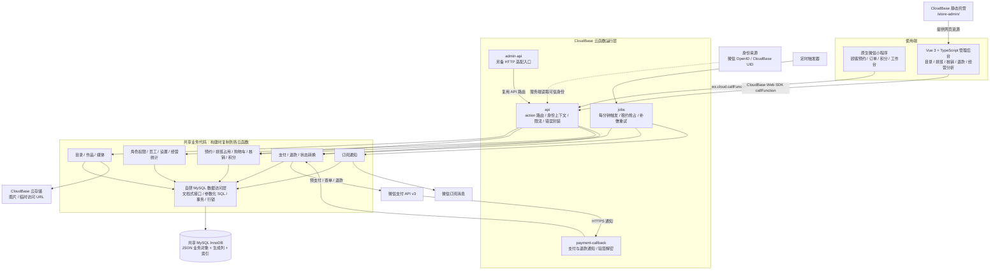

# 系统架构与扩展维护评估

分析日期：2026-10-03。依据当前工作区源码、数据库建表脚本和 CI 配置；未反查线上运行参数，未进行真实数据库并发压测或真实支付测试。

## 结论

系统采用前后端分离、CloudBase Serverless 托管、共享 MySQL 的模块化单体架构。顾客小程序与 Vue 后台共用业务 API，支付回调与定时任务分别部署，但复用同一套业务模块和数据库，因此不属于独立数据边界的微服务架构。

它适合目前单店预约业务及小团队持续迭代。新增项目、款式、技师、附加服务较容易；跨店经营、大规模并发预约和多人并行开发需要进一步治理。优先改进锁粒度、查询边界、测试和发布流程，暂时没有充分理由全面拆成微服务。

## 当前架构图

说明：图中共享业务层表示复用源码，而非单独部署的服务。`admin-api` 复用的是打包进去的 API 路由代码；当前后台实际通过 SDK 调用 `api`，并不默认经过 `admin-api`。本地还保留 `seed` 初始化与 `hello` 示例，不列为主要生产业务链路。

## 分层与关键流程

- 表现层：原生小程序页面与组件；Vue 后台组件、TypeScript 类型和 API 封装。
- 接入层：`api/index.js` 以 `action + payload` 分发，统一请求编号、错误返回、身份上下文及部分业务限流。
- 业务层：目录、预约、支付、员工、统计、核销等模块；模块之间仍有直接依赖。
- 数据层：`db.js` 用 `mysql2` 实现类似文档数据库的接口；建表脚本当前定义 20 张表，主体是 `id + data JSON + 时间字段`，订单、支付、退款和任务等补充生成列、索引与唯一约束。
- 外部服务：CloudBase 身份、静态托管、云存储，以及微信支付和订阅消息。

预约流程在服务端校验报价、目录状态、排班和积分，以事务写入订单、支付记录、占用、积分及相关任务。技师日记录使用行锁避免时段重复占用；请求幂等键避免重复下单。购物车可让多项预约共用一个事务与支付组。

支付使用外部 API，无法和 MySQL 组成一个本地事务，因此通过支付/退款通知、查单、状态转换、持久化任务和周期补偿达到最终一致。后台任务使用租约和抢占令牌处理重复触发或失败恢复，这套可靠性机制是架构的重要优点。

## 扩展性评估

| 维度 | 判断 | 依据及边界 |
| --- | --- | --- |
| 增加项目、作品、技师 | 较好 | 目录与排班已有独立模块和后台入口，主要可通过数据配置扩展 |
| 增加预约规则 | 中等 | 金额、时间、状态规则已有抽取，但预约核心集中在约 1262 行的 booking.js，改动容易牵动支付、积分与排班 |
| API 计算扩容 | 有基础 | 云函数可增加运行实例；实际能力仍取决于线上配额、冷启动、数据库和外部 API，不能从部署形式推算吞吐量 |
| 并发下单 | 需重点改进 | 事务读取默认加 FOR UPDATE，下单共同读取 schedule_templates/active，还锁目录和技师记录，存在跨技师请求共享锁等待 |
| 数据增长 | 中等 | 高频金融字段已有索引与 SQL 聚合；未映射字段使用 JSON 表达式，无法编译的条件可退回全表读取后筛选 |
| 异步任务增长 | 中等 | 单次公平选取最多 50 个任务、按业务分组并发 4；任务积压后需要调整批量、执行预算与触发策略 |
| 多店、多租户 | 较弱 | 当前业务模型未体现贯穿查询、权限、排班、订单和索引的 storeId/tenantId，不能只加一个门店页面完成隔离 |
| 更换云平台 | 有迁移成本 | 业务数据在 MySQL，但身份上下文、调用方式、存储链接、静态托管和定时任务依赖 CloudBase |

两个需要特别关注的瓶颈：

1. **连接数随实例数放大。** 每个进程默认连接池上限为 3，且等待队列没有长度限制。数据库连接总量需要按各函数实例和进程的连接池预算累加；流量突增可能表现为排队、超时，而不只是计算资源不足。
2. **共同记录扩大事务串行范围。** 下单为防止排班变化而锁住 `active` 排班版本记录，多个不同技师的订单也会竞争它。购物车事务包含多个预约，可能进一步延长锁持有时间。这是源码可见的潜在瓶颈，严重程度尚需真实数据库测试。

## 维护性评估

优点：

- 前后端目录清楚，API 调用集中，业务模块已有初步边界。
- 金额、时间、金融状态、身份授权等规则有专用模块；订单保存服务与规则快照，有利于历史追溯。
- 已有请求编号、角色校验、审计相关数据结构、幂等、事务死锁重试和任务补偿。
- CI 包含测试、后台类型检查与构建、JavaScript 语法检查、差异检查以及共享模块同步校验。

主要维护成本：

| 问题 | 影响 | 建议 |
| --- | --- | --- |
| booking.js 同时承载预约、占用、积分和部分金融转换 | 变更范围难控制，测试组合增加 | 保持事务边界，逐步拆出报价、占用、订单状态、积分记账模块 |
| booking 与 payment-service 相互调用 | 业务调用链难追踪 | 用应用服务统一编排，减少双向依赖 |
| 自研文档式 SQL 层约 652 行 | 同时维护条件编译、类型比较、锁行为、整对象更新与回退语义 | 高频领域增加明确的 Repository 和显式 SQL；限制隐式全表回退 |
| 共享模块复制到多个函数 | 手工发布容易出现版本错配；复制不会自动清理遗留模块 | 在发布流水线构建一致的函数包，记录统一版本与哈希 |
| 前端 TypeScript，服务端和小程序主要为 JavaScript | 同一 payload 的契约分散，类型检查不能覆盖调用链 | 建立共享接口定义和运行时输入校验，渐进添加 JSDoc 或 TypeScript |
| 部分测试检查源码字符串或使用模拟环境 | 可以验证约定，却不能证明真实锁竞争与数据库行为 | 补充真实 MySQL 并发、事务回滚和任务租约集成测试 |
| README 与现状有偏差 | 新维护者可能按旧路径部署或误判功能 | README 仍写 /cloud-admin/ 与旧日期，而当前 Vite 使用 /store-admin/，应统一维护 |

已有日志和请求编号，但本次未看到完整的延迟、慢 SQL、连接池等待、任务积压、补偿失败与发布版本关联监控。应将这些指标纳入运维，而不是仅依靠用户报错定位。

## 建议顺序

1. 建立真实 MySQL 集成测试，测量不同技师并发下单、购物车长事务、重复支付通知和租约过期重试；先得到锁等待和事务时长证据。
2. 依据测量收窄排班和目录锁粒度，保留排班变化、归档与下单互斥的正确性；同时设置连接预算、排队上限与超时。
3. 为高频查询建立明确 SQL 与索引，记录无法编译条件的回退，避免静默全表扫描；大列表逐步使用游标分页。
4. 保留模块化单体，拆清预约、金融、积分和通知边界，补上共享 API 契约。
5. 将函数打包、版本校验、测试、发布和回滚串成统一流程，增加任务积压与失败告警，更新入口文档。
6. 确定发展多店时，再贯穿设计门店归属、权限、唯一键、排班版本、支付配置与统计边界。

## 本次验证与源码依据

- 已运行根目录 `npm test`，15 个测试脚本全部通过。过程中有一次媒体解析警告，测试最终退出码为 0。
- 本次未执行数据库集成测试、容量测试、线上配置反查或真实支付退款验收；测试通过不等于生产吞吐能力已验证。
- 未改动业务实现、部署或原有 project.config.json 修改；仅新增本报告。

关键位置：

- `admin/src/cloudbase.ts:43`：管理后台实际调用 api。
- `cloudfunctions/api/index.js:59`：业务路由分发。
- `cloudfunctions/api/lib/auth.js:63`：工作人员角色授权。
- `cloudfunctions/api/lib/db.js:30`：每进程连接池默认上限。
- `cloudfunctions/api/lib/db.js:272`：SQL 查询编译与回退。
- `cloudfunctions/api/lib/db.js:308`：事务内记录读取加行锁。
- `cloudfunctions/api/lib/booking.js:563`：预约下单事务。
- `cloudfunctions/api/lib/booking.js:605`：共同排班版本记录。
- `cloudfunctions/api/lib/cart.js:42`：购物车下单编排。
- `cloudfunctions/api/lib/payment-service.js:443`：支付退款通知处理。
- `cloudfunctions/jobs/index.js:294`：周期补偿与任务处理。
- `scripts/prepare-cloudfunctions.js`：共享源码复制打包。
- `docs/mysql-schema.sql`、`.github/workflows/ci.yml`：数据结构与工程检查。
